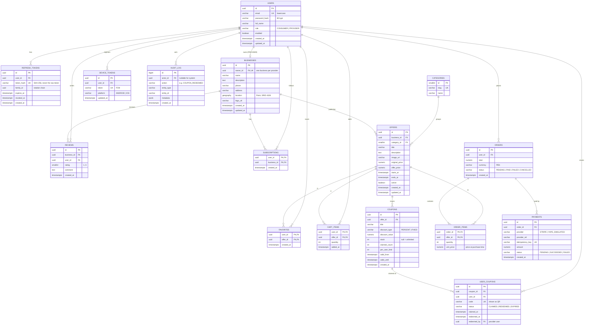

# Data model / Modelo de datos

> 🇪🇸 [Español](#español) · 🇬🇧 [English](#english)

The full model is designed up front; tables are created with Flyway only when the feature that uses them lands.

---

## Español

### Decisiones

- **UUID como clave primaria** en lo que se expone en la API: no revela cuántos registros hay ni permite adivinar IDs ajenos. `categories` y `audit_log` usan claves numéricas porque son internas.
- **`geography(Point, 4326)`** en `businesses.location`: `ST_DWithin` mide en metros reales sobre la Tierra, y un índice GiST mantiene rápida la búsqueda por radio. Las ofertas heredan la ubicación de su negocio.
- **Refresh tokens guardados como hash SHA-256**, nunca en texto plano. Cada uso genera uno nuevo (rotación); si se reutiliza uno ya rotado, se revoca toda su `family_id`, porque indica un robo de token.
- **Cupón vs. cupón reclamado:** `coupons` es la plantilla que crea el proveedor (stock, vigencia); `user_coupons` es el código único que recibe cada consumidor y que se canjea una sola vez.
- **`order_items.unit_price`** guarda el precio del momento de la compra, para que cambiar una oferta no altere pedidos pasados.
- **`payments.idempotency_key` único:** si la app reintenta un pago con la misma `Idempotency-Key`, la base de datos impide cobrar dos veces.
- **`audit_log`** registra acciones sensibles (canjes, pagos, cambios de rol) con `jsonb` para los detalles.
- **Fechas en `timestamptz`** (UTC en la base de datos; la app convierte a hora de Lima).

### Migraciones por sprint

| Migración | Contenido | Día / Sprint |
|---|---|---|
| `V1__enable_postgis` | Extensión PostGIS | Día 1 ✅ |
| `V2__identity` | `users`, `refresh_tokens` | Día 1 |
| `V3__businesses_offers` | `businesses`, `categories` (con datos), `offers` | Día 2 |
| `V4__coupons_audit` | `coupons`, `user_coupons`, `audit_log` | Día 3 |
| `V5+` | Favoritos, reseñas, suscripciones, carrito, pedidos, pagos, dispositivos | Después del MVP |

Una migración aplicada nunca se edita: cualquier cambio va en una migración nueva.

---

## English

### Decisions

- **UUID primary keys** for everything exposed by the API: they hide record counts and prevent guessing other users' IDs. `categories` and `audit_log` use numeric keys because they are internal.
- **`geography(Point, 4326)`** for `businesses.location`: `ST_DWithin` measures real meters on the Earth, and a GiST index keeps radius search fast. Offers inherit their business location.
- **Refresh tokens stored as SHA-256 hashes**, never in plain text. Each use issues a new one (rotation); reusing an already-rotated token revokes its whole `family_id`, since it signals token theft.
- **Coupon vs. claimed coupon:** `coupons` is the provider's template (stock, validity); `user_coupons` is the unique code each consumer gets, redeemable once.
- **`order_items.unit_price`** stores the price at purchase time, so editing an offer never changes past orders.
- **Unique `payments.idempotency_key`:** if the app retries a payment with the same `Idempotency-Key`, the database prevents a double charge.
- **`audit_log`** records sensitive actions (redemptions, payments, role changes) with `jsonb` details.
- **`timestamptz` everywhere** (UTC in the database; the app converts to Lima time).

### Migrations per sprint

| Migration | Content | Day / Sprint |
|---|---|---|
| `V1__enable_postgis` | PostGIS extension | Day 1 ✅ |
| `V2__identity` | `users`, `refresh_tokens` | Day 1 |
| `V3__businesses_offers` | `businesses`, `categories` (seeded), `offers` | Day 2 |
| `V4__coupons_audit` | `coupons`, `user_coupons`, `audit_log` | Day 3 |
| `V5+` | Favorites, reviews, subscriptions, cart, orders, payments, devices | After the MVP |

An applied migration is never edited: any change goes into a new migration.
